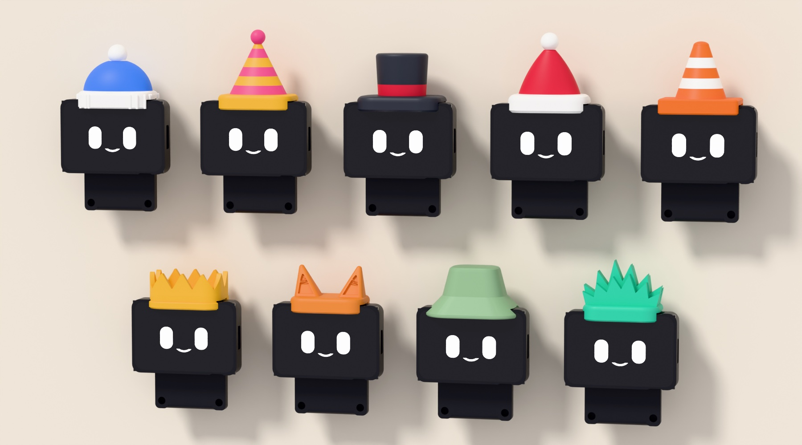
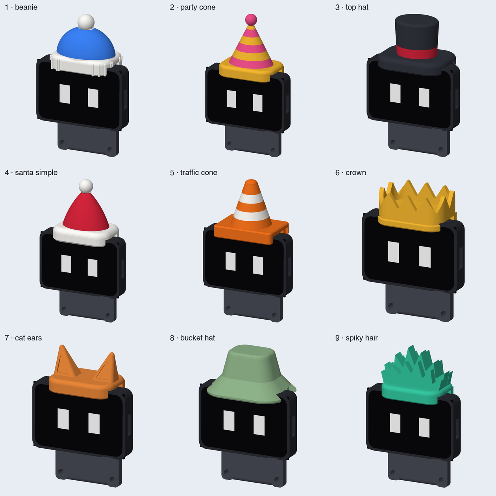

# Hats for the Taby 1.64

Small printed hats that clip onto the top edge of a Taby 1.64 in its printable desktop case.
Every hat is the same clip with a different shape on top, so you can print one of these or make your own.

**Status.** The clip's grip was picked from five printed test clips on 2026-11-20 (Bambu Lab P2S, 0.4 mm
nozzle, PLA). The nine hats below are built on that clip and checked against the case model. They had not
been printed yet when this was written.

## Pick a hat

Each hat has its own folder with a one-piece STL, one STL per colour when it has two, and a Bambu Studio
project (`.3mf`, Bambu Lab P2S, 0.08 mm layers, colours already assigned).

| Hat | Colours | Colour swaps per plate | Size (mm) |
|---|---|---|---|
| [beanie](beanie) | white, blue | 2 | 34 x 24 x 27 |
| [party-cone](party-cone) | yellow, pink | 7 | 33 x 23 x 34 |
| [top-hat](top-hat) | black, red | 2 | 36 x 26 x 24 |
| [santa-simple](santa-simple) | white, red | 2 | 33 x 23 x 33 |
| [traffic-cone](traffic-cone) | orange, white | 4 | 33 x 23 x 30 |
| [crown](crown) | one | 0 | 32 x 23 x 15 |
| [cat-ears](cat-ears) | one | 0 | 32 x 22 x 20 |
| [bucket-hat](bucket-hat) | one | 0 | 38 x 30 x 21 |
| [spiky-hair](spiky-hair) | one | 0 | 32 x 22 x 25 |

Colours are level bands stacked by height, so a layer is never two colours. The printer swaps filament once
per band for the whole plate, however many hats are on it. Any hat also prints in a single colour from its
one-piece STL.

## Print one

- Print it standing, clip down, exactly as the file is oriented.
- Supports: only under the roof inside the clip, from the bed. Block supports around the two springs
  (everything behind Y 12.8 mm, below Z 4.8 mm), or they fuse to the springs and the clip stops working.
  The `.3mf` projects already do this.
- Nothing outside the clip needs support.
- Layer height: the projects use 0.08 mm for smooth curves. 0.2 mm also works.
- With a different slicer, import the colour STLs of one hat together as parts of one object, so they stay
  aligned.

## Put it on

Hold the hat with its springs at the back and push it straight down over the Taby's top edge until it sits.
It fits with the back plate hanging down or turned to either side. It covers the top 3.7 mm of the front.

## How the clip holds

- The clip drops over the case body (9.03 mm deep) plus the back plate (5.00 mm): 14.03 mm in all.
- A rigid lip sits in front of the glass. Two leaf springs behind the back plate press it forward.
- Nothing near the top of the case can be hooked, so the clip is a clamp. It holds by squeeze and friction.
- The back plate's top rear edge is rounded (2 mm radius). The springs must press below that round, on the
  flat face, or they push the hat up and off. This is why the channel is 4.0 mm deep and the spring bumps
  are square down to the bed.
- The back plate's top stands about 0.3 mm above the body's top, so the roof inside the clip is 0.2 mm lower
  over the body. The clip then rests on both.

If the grip is wrong on your printer, change `GRIP` in `taby_hat_clip.py`, print the bare clip
(`clip/taby-hat-clip-base.stl`), and try it.

| `GRIP` (mm) | Squeeze per spring (calculated) | |
|---|---|---|
| 0.3 | about 1.3 N | loosest tested |
| 0.5 | about 2.2 N | |
| 0.7 | about 3.1 N | chosen |
| 0.9 | about 3.9 N | |
| 1.1 | about 4.8 N | springs bend close to what PLA can take |

## Make your own hat

You need Python with `numpy` and `manifold3d`. Give this folder to an AI assistant such as Claude, or edit
the scripts yourself.

- `taby_hat_clip.py` builds the clip. `attach(hat)` joins any solid to it and cuts away whatever would enter
  the clip's channel or go below the bed, so the result always fits and the springs stay free.
- `simple_hats.py` builds the nine hats here. Copy one of its functions as a starting point, add it to
  `HATS`, and run `python simple_hats.py your-hat`. It prints three checks for each hat: one piece, no
  overhang, clip hidden.
- `update_manifest.py` refreshes the checksums in `print.json` after files change.

Coordinates (mm, print orientation):

- X: across the Taby, 0 at the centre, + toward the USB-C side.
- Y: depth, 0 at the glass, + toward the back. The clip spans Y -2.3 to 18.3.
- Z: up, 0 at the print bed. The clip's flat top is at Z 5.4. On the Taby, Z 4.0 is the top edge.

Rules that keep a hat printable:

1. Start the shape below the clip's top (Z 5.4) so it fuses with the clip, and make its base wider than
   the clip (`plan(1.0)` or more) from the bed up, so the clip is hidden.
2. Let it only get narrower, or lean a little, on the way up. Keep overhangs under about 50 degrees from
   vertical. Put a ball on top with `drop()`, which adds a cone under it.
3. On the front, do not go below the bed (Z 0): that is already 3.7 mm down the Taby's face.
4. Keep it light and not much wider than the Taby (47 mm). A tall or heavy hat tips more easily.
5. For colours, cut the finished hat into level bands by height. Start a band 0.1 mm above a flat face,
   never exactly on it.
